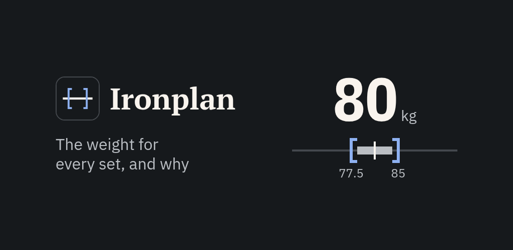
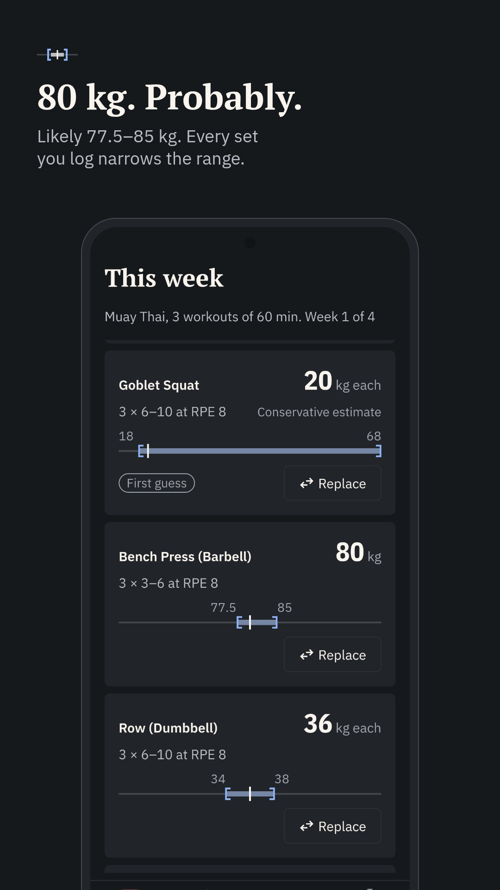
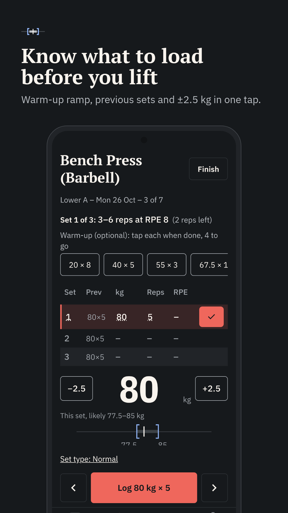
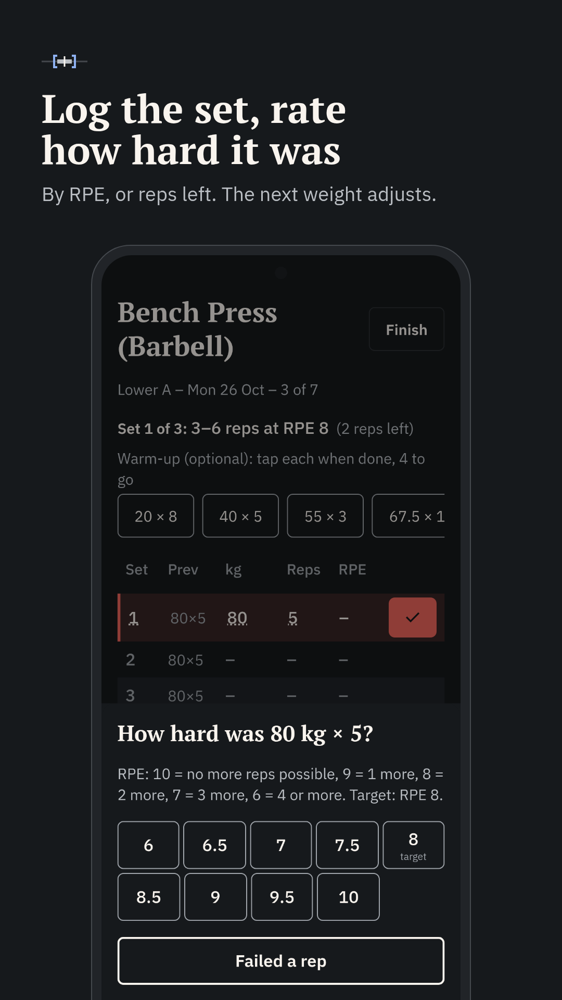
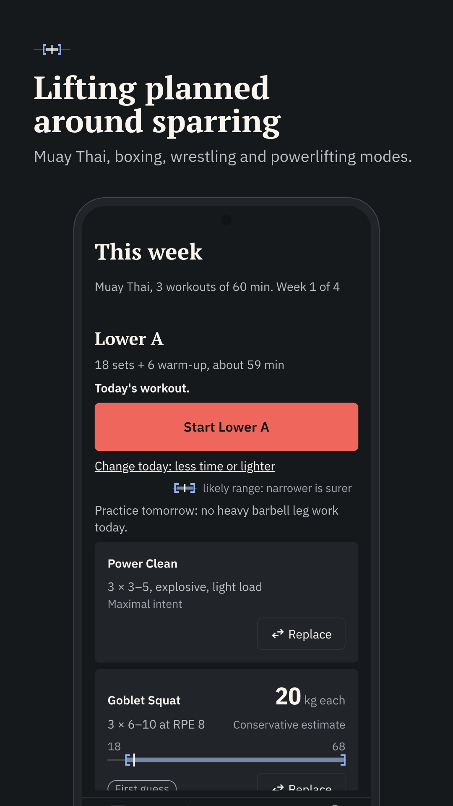
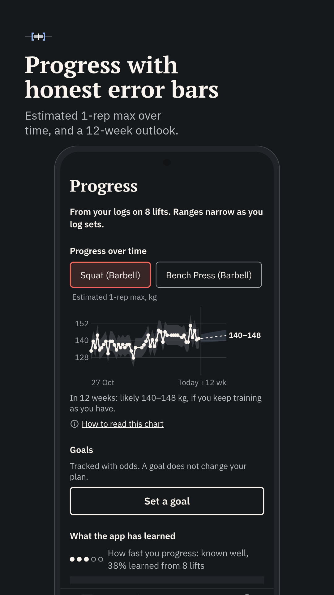
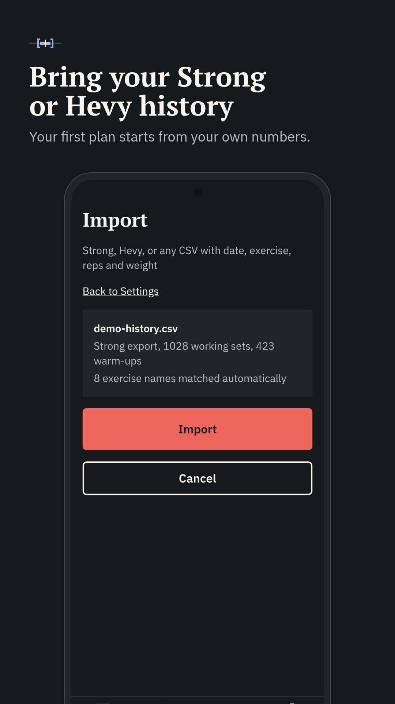

# IronPlan
Open source exercise plan generation based on Bayesian hierarchical modeling. Plans update after data is collected to be further refined for user target (e.g. for MMA, Powerlifting, General Health). Optimizes both exercises, weight, and volume.

## Analysis
TODO:

## Screenshots

<table>
  <tr>
    <td></td>
    <td></td>
    <td></td>
  </tr>
  <tr>
    <td></td>
    <td></td>
    <td></td>
  </tr>
</table>

## Privacy
All models, data, notifications are entirely local. No data is sent to any server. The application can work entirely offline.

## Health Notice
Ironplan is not a medical device and does not diagnose, treat, cure, or prevent any medical condition. Consult a healthcare professional before starting a new training programme, and for medical advice, diagnosis or treatment.
