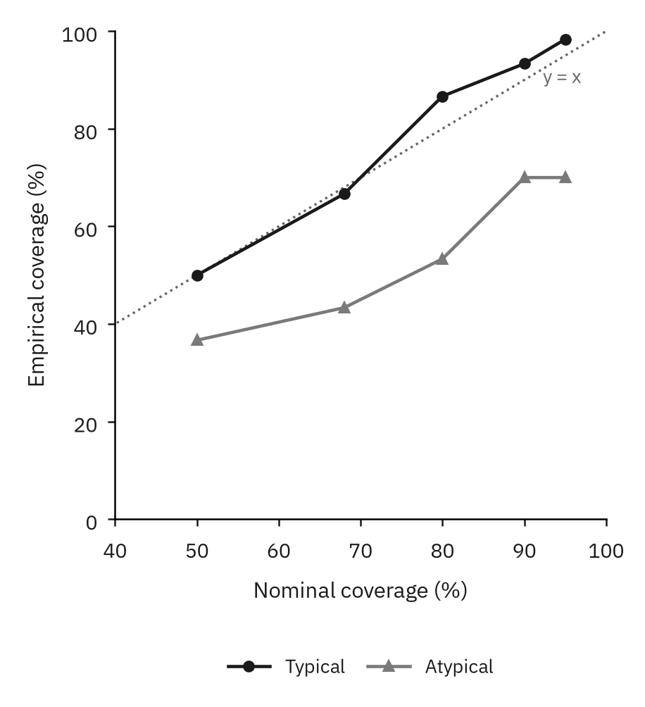
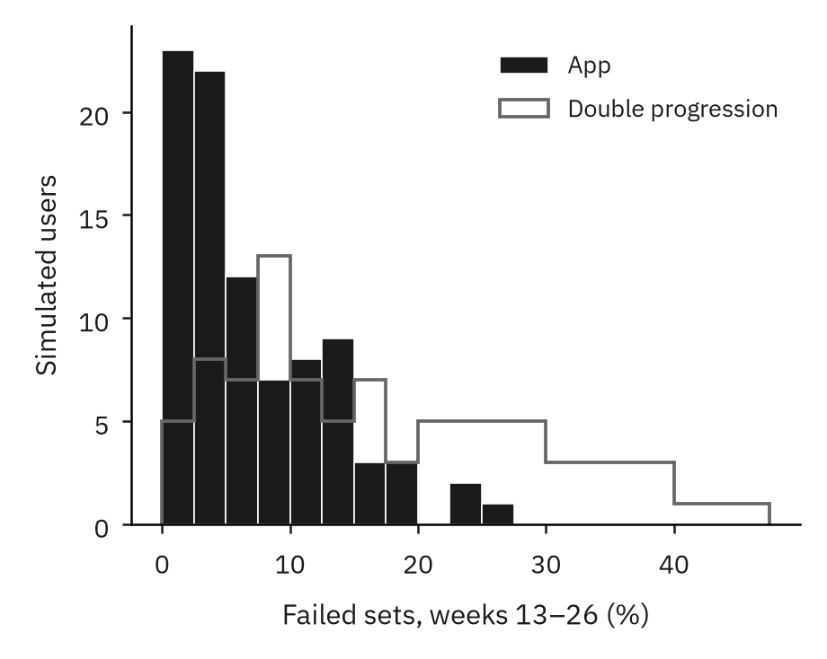
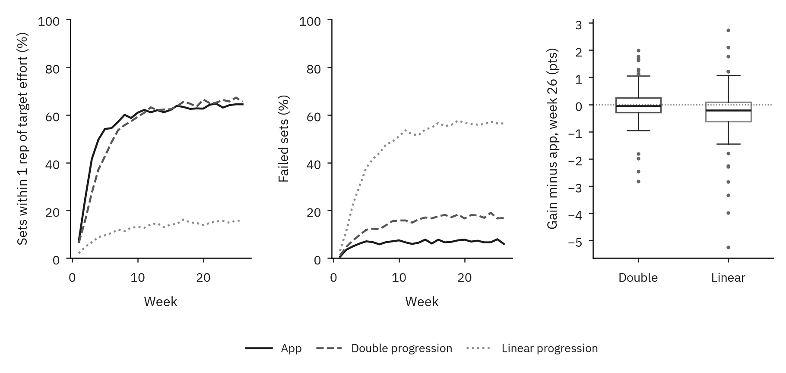

# IronPlan


Open source exercise plan generation based on Bayesian hierarchical modeling. Plans update after data is collected to be further refined for user target (e.g. for MMA, Powerlifting, General Health). Optimizes exercises and weight. Volume optimization is experimental.


<table>
  <tr>
    <td></td>
    <td></td>
    <td></td>
  </tr>
  <tr>
    <td></td>
    <td></td>
    <td></td>
  </tr>
</table>

## Download
Android only for now. Get the APK from [Releases](https://github.com/I-naY-reversed/IronPlan-WorkoutPlanner/releases) and open it on your phone. Android will ask you to allow installs from your browser or file manager the first time.

Current releases are pre-releases.

### Build from source
Requires Node 22.

```bash
cd mobile
npm ci
npm run web
npm run android
```

Tests: `npm run typecheck`, `npm run lint`, `npm test`.

## Analysis
We plot the results from a simulation of 90 users over 26 weeks, each with a known optimal weekly dose per muscle. Note, this uses the same priors as the app. Typical refers to typical responders. Atypical users respond much better or much worse than the population average (twice the usual spread; see [analysis/optimization](analysis/optimization) for details).
<table>
<tr>
  <td></td>
  <td></td>
</tr>
</table>

The error bars are accurate for typical users: 68% ranges contained the true value 67% of the time, and 95% ranges 98% of the time. For atypical users they are too narrow (70% at 95%). Volume prescription is still a work in progress. The app did not beat the research default, and deliberately raising and lowering volume did not help it learn a user's response to volume within 26 weeks.

However, against fixed programmes (same users, exercises and starting weights), the app reached the target effort about **two weeks sooner** and had less than **half the failed sets** of double progression (7% vs 17%), with the same strength gains.



### Reproduction
Requires Node 22 and Python with matplotlib and numpy. Each simulation takes about 40 minutes on around-average hardware.
```bash
cd mobile
export SIM_OBS=matched
for l in app double linear; do SIM_LOADS=$l SIM_OUT=../analysis/optimization/results-$l.json npx jest --testMatch '**/__sim__/population.sim.ts'; done
cd ../analysis/optimization
python3 plots.py
python3 versus.py
```

## Privacy
All models, data, notifications are entirely local. No data is sent to any server. The application can work entirely offline.

## Health Notice
IronPlan is not a medical device and does not diagnose, treat, cure, or prevent any medical condition. Consult a healthcare professional before starting a new training programme, and for medical advice, diagnosis or treatment.
